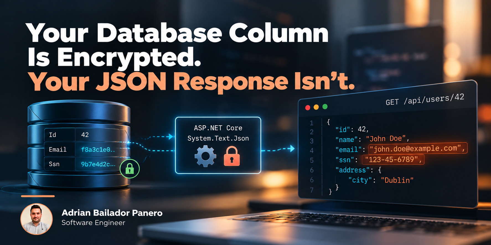

## Code

Full runnable demo, with tests: [stj-property-encryption-dotnet](https://github.com/AdrianBailador/stj-property-encryption-dotnet).

## The Leak Nobody Flagged in the Security Review

A SOC 2 audit two years ago flagged customer PII sitting in plaintext in the database. The fix was the standard one: an EF Core `ValueConverter` wrapping `Email` and `Ssn` in AES before `SaveChangesAsync`, decrypting them back out on the way through the `DbContext`. The audit closed. Everyone moved on.

Last month, a support engineer debugging a billing issue pasted the raw response from `GET /api/users/42` into a shared Slack channel to show a teammate what the API was returning. The response had a customer's email and SSN sitting right there in the JSON, in plaintext, for anyone in that channel to read — and for Slack's own servers to store indefinitely.

The database was never the problem. `EncryptionHelper` and the `ValueConverter` did exactly what they were built to do: nothing reaches disk unencrypted. But EF Core decrypts those columns back into plain C# strings the moment it hydrates the entity, because the application needs the real values to do anything useful with them. From that point on, `Email` and `Ssn` are just `string` properties on a POCO — and every serializer in the process, `System.Text.Json` included, treats them exactly like `Name` or `City`. The column was encrypted. The object in memory was not. Neither was the response.

*(A composite of two scenarios that play out the same way in enough codebases that naming a specific one wouldn't add anything — the audit-then-decrypted-leak pattern is the point, not the particular Slack channel it happened in.)*

## Where This Actually Lives: the Serialization Boundary, Not the Persistence Layer

Encrypting a column protects data **at rest** — on disk, in a backup, in a stolen database file. It says nothing about data **in transit through your own process**: API responses, structured logs, outbound webhook payloads, anything that calls `JsonSerializer.Serialize` on an object holding that value. Those are two different quality attributes solving two different threats, and treating one as a substitute for the other is how a "we encrypt sensitive data" checkbox survives an audit while a raw response still leaks a social security number into a chat tool.

The obvious fix is a custom `JsonConverter<T>` — but a converter is attached to a *type*. Writing one for `User` means hand-rolling the entire object's read/write logic just to intercept two fields out of several, re-implementing it by hand every time `User` gains a new property. The alternative is wrapping each sensitive field in its own type (`EncryptedString` instead of `string`) so a per-type converter has something narrower to target — and that wrapper leaks into your domain model, your EF Core mappings, and every place that reads `user.Email`. Neither approach scales to "any property on any type that happens to need this," which is exactly the shape of the actual problem.

`System.Text.Json`'s contract customization API solves the actual problem: a `JsonTypeInfo` **modifier** runs once per type, when its serialization contract is built, and can rewrite how any individual property is read or written — without changing its declared type. You mark the property, not the type:

```csharp
public sealed class User
{
    public required int Id { get; set; }
    public required string Name { get; set; }

    [Encrypted]
    public required string Email { get; set; }

    [Encrypted]
    public required string Ssn { get; set; }

    public required Address Address { get; set; }
}

public sealed class Address
{
    public required string Street { get; set; }
    public required string City { get; set; }

    [Encrypted]
    public required string PostalCode { get; set; }
}
```

`User` and `Address` are plain POCOs. Nothing here says "encrypted" beyond an attribute that's meaningless to EF Core, to a unit test, to anything that isn't specifically looking for it. That's the point — the serializer is the only thing that needs to care.

## The Modifier: Rewriting `Get` and `Set` for One Attribute

A `JsonTypeInfo` exposes its properties as a mutable collection during contract resolution. Each `JsonPropertyInfo` carries an `AttributeProvider` — the reflection metadata for the backing member — and two delegates: `Get`, called when serializing, and `Set`, called when deserializing. A modifier is just a function that walks that collection and replaces those delegates for the properties it cares about:

```csharp
public static class EncryptionTypeInfoModifier
{
    public static Action<JsonTypeInfo> Create(IPropertyEncryptor encryptor)
    {
        return typeInfo =>
        {
            if (typeInfo.Kind != JsonTypeInfoKind.Object)
            {
                return;
            }

            foreach (var property in typeInfo.Properties)
            {
                var isEncrypted = property.AttributeProvider
                    ?.GetCustomAttributes(typeof(EncryptedAttribute), inherit: false)
                    .Length > 0;

                if (!isEncrypted)
                {
                    continue;
                }

                if (property.PropertyType != typeof(string))
                {
                    throw new InvalidOperationException(
                        $"[Encrypted] on '{typeInfo.Type.Name}.{property.Name}' requires a string property, " +
                        $"but '{property.Name}' is '{property.PropertyType.Name}'.");
                }

                var originalGet = property.Get;
                var originalSet = property.Set;

                if (originalGet is not null)
                {
                    property.Get = instance =>
                    {
                        var plaintext = (string?)originalGet(instance);
                        return plaintext is null ? null : encryptor.Encrypt(plaintext);
                    };
                }

                if (originalSet is not null)
                {
                    var propertyName = property.Name;
                    var declaringTypeName = typeInfo.Type.Name;

                    property.Set = (instance, value) =>
                    {
                        var ciphertext = (string?)value;
                        if (ciphertext is null)
                        {
                            originalSet(instance, null);
                            return;
                        }

                        string plaintext;
                        try
                        {
                            plaintext = encryptor.Decrypt(ciphertext);
                        }
                        catch (Exception ex) when (ex is FormatException or CryptographicException)
                        {
                            throw new JsonException(
                                $"'{declaringTypeName}.{propertyName}' is marked [Encrypted], but the incoming " +
                                "value isn't valid ciphertext for the configured key.", ex);
                        }

                        originalSet(instance, plaintext);
                    };
                }
            }
        };
    }
}
```

Three details earn their keep here. First, the `typeInfo.Kind` guard at the top — `Get`/`Set` rewriting is only meaningful for `Object` contracts; a `List<T>` or `Dictionary<TKey,TValue>` contract doesn't expose properties the same way, and the Microsoft documentation for `JsonTypeInfo.Properties` is explicit that this mutation path applies to object contracts. Skipping early is cheap and keeps the modifier correct if it ever runs against a contract kind it wasn't written for. Second, the type check isn't optional — `[Encrypted]` on an `int` or a `DateTime` fails the moment the contract is built, with a message naming the exact type and property, instead of an `InvalidCastException` three call frames deep inside `System.Text.Json` the first time something tries to serialize it. Third, `Set` catches only `FormatException` and `CryptographicException` — the two exceptions a real decryption failure can actually throw — and rethrows as `JsonException`; anything else propagates unchanged, because a bug in `IPropertyEncryptor` itself shouldn't get relabeled as "bad input."

Wiring it in is one line on `JsonSerializerOptions`:

```csharp
var encryptedOptions = new JsonSerializerOptions(JsonSerializerDefaults.Web)
{
    TypeInfoResolver = new DefaultJsonTypeInfoResolver()
        .WithAddedModifier(EncryptionTypeInfoModifier.Create(encryptor))
};
```

## One Resolver, Two Directions

`Get` runs on the way out, `Set` runs on the way in — the same `JsonSerializerOptions` handles both, which is convenient right up until it isn't. If an endpoint accepts a request body and you bind it with `encryptedOptions`, every `[Encrypted]` property on that payload is assumed to already be ciphertext this encryptor produced. A client sending a plain `"jane.doe@example.com"` for `Email` on a signup request isn't sending malformed JSON — it's sending exactly what the field name says. Without the `try`/`catch` in `Set`, that call falls straight into `Convert.FromBase64String` or `AesGcm.Decrypt` and surfaces whatever exception they happen to throw, several layers away from anything that explains what actually went wrong.

The fix isn't cleverer code, it's a clearer boundary: decide per endpoint whether the body you're reading is plaintext input from a client or ciphertext round-tripped from one of your own previous responses, and don't use `encryptedOptions` for the former. This demo's two endpoints are both reads, so the question never comes up — but the moment you add a `PUT` that accepts a new email address, that handler needs `plainOptions` for binding, encrypting the value explicitly before it's persisted, not the resolver that assumes every incoming value is already encrypted. The `JsonException` in `Set` exists for the case this still slips through: it names the exact property and says plainly that the value wasn't valid ciphertext, instead of leaving you to decode a `FormatException` or an `AuthenticationTagMismatchException` thrown from inside a third-party serializer.

This also means `/secure/users/{id}` is only a useful response for a caller that can decrypt it. In this demo that's deliberately left open — the point is to show the mechanism — but in a real system, whoever calls that endpoint needs the key, or the endpoint needs to exist for a different consumer than the one calling `/users/{id}`: another backend service, a batch job, something that's supposed to see the real value and holds the key to prove it. Encrypting the response doesn't change who can ultimately read the data, only who can read it as it crosses this one boundary. A caller holding the key can decrypt, log, or forward the plaintext exactly as freely as if it had never been encrypted at all.

## The Encryptor Behind `IPropertyEncryptor`

The modifier doesn't know or care how encryption happens — it depends on an interface:

```csharp
public interface IPropertyEncryptor
{
    string Encrypt(string plaintext);
    string Decrypt(string payload);
}
```

The implementation uses AES-GCM, which is authenticated encryption — it detects tampering, not just hides content — with a fresh random nonce per call, so encrypting the same value twice never produces the same ciphertext twice:

```csharp
public string Encrypt(string plaintext)
{
    var plaintextBytes = Encoding.UTF8.GetBytes(plaintext);
    var nonce = RandomNumberGenerator.GetBytes(NonceSize);
    var ciphertext = new byte[plaintextBytes.Length];
    var tag = new byte[TagSize];

    using (var aesGcm = new AesGcm(_key, TagSize))
    {
        aesGcm.Encrypt(nonce, plaintextBytes, ciphertext, tag);
    }

    var payload = new byte[NonceSize + TagSize + ciphertext.Length];
    Buffer.BlockCopy(nonce, 0, payload, 0, NonceSize);
    Buffer.BlockCopy(tag, 0, payload, NonceSize, TagSize);
    Buffer.BlockCopy(ciphertext, 0, payload, NonceSize + TagSize, ciphertext.Length);

    return Convert.ToBase64String(payload);
}
```

The nonce and the authentication tag travel with the ciphertext in the same base64 string, so `Decrypt` doesn't need anywhere else to look them up. This is also why the "same plaintext in, different ciphertext out" property matters for a demo claiming to be production-shaped: a field that always encrypts to the same value is a fingerprint, not a secret — anyone who can see two responses can tell whether two users share an email without ever decrypting either one.

`Decrypt` checks the payload is at least `NonceSize + TagSize` bytes before it tries to slice a nonce and a tag out of it — a short string that happens to be valid base64 (user input landing in the wrong place, for instance) would otherwise fail a byte-array slice with an unrelated-looking exception instead of a message that says what's actually wrong.

## Before / After

### Before ❌

```csharp
app.MapGet("/users/{id:int}", (int id) =>
    users.TryGetValue(id, out var user)
        ? Results.Text(JsonSerializer.Serialize(user, plainOptions), "application/json")
        : Results.NotFound());
```

```json
{
  "id": 42,
  "name": "Jane Doe",
  "email": "jane.doe@example.com",
  "ssn": "078-05-1120",
  "address": { "street": "1 Market St", "city": "Dublin", "postalCode": "D02 AF30" }
}
```

`plainOptions` is a default `JsonSerializerOptions`. The database column was encrypted. This response isn't — and it's the response, not the column, that ends up in a browser dev tools tab, a support ticket attachment, or a Slack message.

### After ✅

```csharp
app.MapGet("/secure/users/{id:int}", (int id) =>
    users.TryGetValue(id, out var user)
        ? Results.Text(JsonSerializer.Serialize(user, encryptedOptions), "application/json")
        : Results.NotFound());
```

```json
{
  "id": 42,
  "name": "Jane Doe",
  "email": "RiWPxVsYwFpr9y7O/ObDdAGoW31inngQR3LslYlfm12AKw/PdyGj2C2lAJXTXlUh",
  "ssn": "nKvWH5Ylan1hNIPt10yvsiuHI4ONS8u0Z0mZsYiS2dUaJwFkKTEB",
  "address": {
    "street": "1 Market St",
    "city": "Dublin",
    "postalCode": "se4eSO+KdhIvlWCdMwdSqlbj4Ws3IyOdU7rEZB7yTMBi3+jU"
  }
}
```

Same `User`, same `Address`, same handler — `encryptedOptions` is the only difference. `Name`, `Street`, and `City` stay readable because nothing marked them `[Encrypted]`; `Email`, `Ssn`, and the nested `Address.PostalCode` don't, including inside the nested object, without a separate converter for `Address`.

**Impact:** every marked property's value is encrypted when it's serialized through this specific `JsonSerializerOptions` — the HTTP response here, or anywhere else that explicitly reuses the same options. It says nothing about direct in-memory access to `user.Email`, a different serializer in the same process, or a structured logger with its own JSON formatter — those are separate paths that need their own control, not an assumption that this one already covers them. The domain model, the EF Core mapping, and the database schema don't change at all.

## Encryption Is Not Redaction

Before reaching for this pattern, check a simpler question first: does the caller need this field at all? An endpoint that lists users for an internal admin dashboard might have no business returning `Ssn` in any form, encrypted or not. The right fix there is a DTO that omits the field entirely — a property that faithfully returns its ciphertext is still answering a question nobody should have asked. Encrypting a value you shouldn't be sending still sends it; the data has left the process either way, just unreadable to whoever shouldn't have it and to anyone else who intercepts it along the way. If the honest answer is "this response shouldn't carry that field," the fix is projection, not cryptography.

That's the general shape of the decision: each of these threats has a control shaped for it, and they're not interchangeable.

| Need | Reach for |
|---|---|
| Protecting stored data | At-rest / column-level encryption |
| Protecting data on the wire between client and server | TLS |
| Not returning fields a caller doesn't need | A purpose-built DTO, not the full entity |
| Keeping sensitive values out of logs | Redaction or property filtering in the logging pipeline |
| Deliberately encrypting specific fields of a JSON payload | A `JsonTypeInfo` modifier |
| Stopping one caller from reading another caller's data | Authorization, not encryption |

A `JsonTypeInfo` modifier answers exactly the fifth row. It's not a substitute for the other five, and using it as one just moves where a problem lives without closing it.

## Pitfalls in Production

- **The same resolver that encrypts a response will try to decrypt a request.** If an endpoint binds a request body with `encryptedOptions` and the client sends a plain value for an `[Encrypted]` property, that's not malformed input from the resolver's point of view — it's a value that fails to decrypt. Decide per endpoint whether you're reading your own ciphertext back or a client's plaintext input, and don't default to the encrypting resolver for the latter.
- **This protects the serializer you wire it into — and reusing it for logs isn't the fix either.** A logging call like `logger.LogInformation("{@User}", user)` through a structured logger generally serializes with its own formatter, one that's never heard of `EncryptionTypeInfoModifier`, and writes the plaintext object straight into your log sink. But even wiring the same `encryptedOptions` into that logger doesn't make the result right — a log line full of ciphertext is still capturing a value it had no business holding. Redact or drop sensitive fields in the logging pipeline directly; reserve this resolver for serialization paths where encrypted output is the actual desired output, like the HTTP response itself.
- **Build `JsonSerializerOptions` once and reuse it.** A modifier runs when a type's `JsonTypeInfo` is first resolved, and `System.Text.Json` caches that per `JsonSerializerOptions` instance. Constructing a fresh `JsonSerializerOptions` with the resolver chain on every request throws that cache away and rebuilds the whole contract, property by property, on every single call.
- **A property with no `Set` delegate doesn't just skip decryption — it can hand you back the wrong value entirely.** The modifier guards on `if (originalSet is not null)` for a reason: a get-only property backed by a constructor parameter (no parameterless constructor, no settable backing field) never gets a reflection setter, so `System.Text.Json` populates it straight from the raw constructor argument instead, bypassing `Set` altogether. Serialization still encrypts it correctly on the way out. Deserialization, with no setter to intercept, lets the ciphertext go straight into the constructor — the resulting object's property holds ciphertext, not the original value, with no exception to flag it. Treat every type you mark as needing its own tested deserialization path, including types built through a parameterized constructor, not just a shared "does it look encrypted" assertion.
- **Nonce reuse is the one mistake that breaks AES-GCM's security guarantee outright — and there's no single safe number of operations to cite.** This demo generates a fresh random 96-bit nonce per call via `RandomNumberGenerator`, which is the right default for a property-level encryptor. How much volume that tolerates under one key depends on message size, how many messages share that key, and the security margin your threat model actually needs — not a fixed operation count. A high-throughput system needs an explicit answer for nonce tracking, and a separate one for key rotation: when you retire a key, something still has to decrypt the payloads encrypted under the old one, which means versioning which key encrypted which value.
- **This is a confidentiality control, not a storage strategy.** Ciphertext isn't queryable, sortable, or indexable by the database that eventually stores it. If the field is both persisted and serialized, you need the persistence-layer answer too — a `ValueConverter`, column-level encryption, or whatever your data layer uses — and the two don't have to use the same key or even the same algorithm.
- **A compile-time attribute isn't a compile-time guarantee here.** `[Encrypted]` on the wrong property type fails at startup, the first time that type's contract is built — not at compile time, because this is a reflection-based resolver reading attributes at runtime. If you need the stronger guarantee, the equivalent check in a Roslyn source generator would catch it before the build even finishes.

## Best Practices

1. **Match the control to the actual threat instead of reaching for the most impressive one.** If the real fix is "stop returning this field," a DTO solves it in one line and leaves nothing to decrypt. Save encryption for the case where the caller genuinely needs the value and the only question is how it travels.
2. **Treat serialization-boundary encryption and at-rest encryption as two separate controls.** Each protects a different threat (a leaked API response vs. a stolen database file). Don't let one satisfy an audit requirement meant for the other.
3. **Fail loudly on misconfiguration, in both directions.** `InvalidOperationException` for the wrong property type and `JsonException` for non-ciphertext input both turn a silent data-handling bug into something that fails the first smoke test instead of surfacing in a postmortem months later.
   ```csharp
   if (property.PropertyType != typeof(string))
   {
       throw new InvalidOperationException(
           $"[Encrypted] on '{typeInfo.Type.Name}.{property.Name}' requires a string property...");
   }
   ```
4. **Use authenticated encryption with a per-value random nonce, never a fixed one.** AES-GCM with `RandomNumberGenerator.GetBytes` per call means identical plaintexts never produce identical ciphertexts — a deterministic scheme leaks equality even without ever decrypting anything.
5. **Keep the key out of the repository you're reading this from — and plan its lifecycle, not just its storage.** This demo loads a base64 key from `appsettings.json` for clarity; a real deployment pulls it from a key vault or secret manager, not a config file checked into source control. Storing it safely doesn't by itself answer what happens when the key rotates: something still needs to know which key encrypted which value, so a real deployment versions its keys and decides that up front, not when the first rotation breaks decryption for old data.
6. **Test both directions explicitly, including the failure modes.** A modifier that only gets exercised by a "the response looks encrypted" assertion can still be silently broken on the deserialize path. Round-trip every annotated type, including nested and collection properties, and assert that plaintext input and wrong-key ciphertext both fail clearly instead of corrupting data or throwing something unreadable.
7. **Apply explicit redaction in the logging pipeline — don't assume this resolver reaches it.** A modifier scoped to one `JsonSerializerOptions` instance protects exactly that instance's call sites, and a structured logger almost never shares it. Reuse the encrypting options for other *serialization* paths that deliberately need the same ciphertext a client would see — a background job, an outbound webhook built from the same model — but handle logs as their own control.
8. **Reach for a modifier before reaching for a converter-per-type.** A converter changes a type's entire serialization behavior; a modifier changes specific properties across every type that has them, including ones you haven't written yet. For a cross-cutting concern like "which fields are sensitive," that's the better default.

## Conclusion

Encrypting a database column answers "what happens if someone steals the disk." It says nothing about "what happens the first time that value is serialized back out of the process that just decrypted it" — and most sensitive data spends far more of its lifetime in memory, in a response body, or in a log line than it ever spends sitting in a backup. A `JsonTypeInfo` modifier closes that specific gap: it's a serialization-time control, scoped to the properties that actually need it, that never touches the domain model, the EF Core mapping, or anything that isn't `System.Text.Json` itself.

Reach for this when the thing you're protecting is "what crosses this specific serializer's boundary," and the caller genuinely needs the value — not when the simpler fix is a DTO that doesn't return the field at all, not as a substitute for at-rest encryption, TLS, or authorization, and not as a stand-in for redacting what your logger captures, each of which answers a different question. And once you're comfortable rewriting `Get`/`Set` for one attribute, the same `WithAddedModifier` chain is how you'd implement field-level redaction for a lower trust level, audit logging on read, or masking in non-production environments — encryption is one instance of a much more general technique: changing what a property means at the serialization boundary without changing what it means anywhere else.
