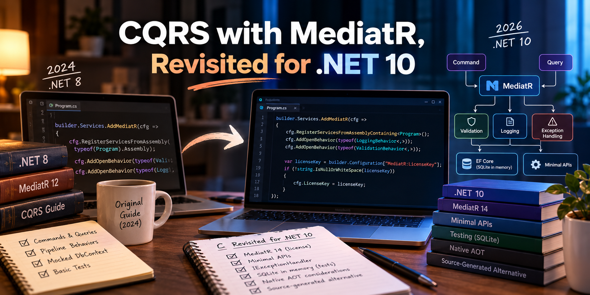

## Code

Full runnable solution — API, pipeline behaviors, tests, and a side-by-side comparison against a source-generated alternative: [cqrs-mediatr-dotnet10](https://github.com/AdrianBailador/cqrs-mediatr-dotnet10).

## Rebuilding Instead of Patching

In 2024 I wrote a guide to implementing CQRS with MediatR on .NET 8. It did well — picked up, shared, still shows up when people search for MediatR and CQRS together. People used it to learn the pattern, and some of them are still running the code from it, unmodified, in production.

Two years felt like enough distance that patching the original in place wasn't going to cut it, so I rebuilt it from scratch — new project, new tests, same pattern — on .NET 10 and the current MediatR, rather than diff the old code against new package versions and call it current. The pattern itself didn't need reinventing. What was worth a second look was everything sitting around it: what MediatR's license actually asks of you now, which parts of the original code were weaker than they looked, and what .NET 10 does differently by default.

## Setup, and What the License Requires

MediatR changed its license in July 2025 — the last Apache 2.0 release was 12.5.0, and from 13.0 onward it's dual-licensed (RPL-1.5, or commercial) through [Lucky Penny Software](https://www.jimmybogard.com/automapper-and-mediatr-commercial-editions-launch-today/). For most people this changes nothing you'll actually feel: the Community edition is free under $5,000,000 in gross annual revenue, and you register a key at [mediatr.io](https://mediatr.io) and set it via `MEDIATR_LICENSE_KEY`. Skip it and MediatR logs a reminder; it doesn't break anything.

I wrote about [building CQRS without MediatR entirely](https://adrianbailador.github.io/blog/57-cqrs-without-mediatr-dotnet/) back when the license change was the news — that's the article for "I want this pattern with zero third-party dependency." This one assumes you're staying on MediatR, or close to it, and cares about what else is different.

The registration looks like this, with the key wired to configuration instead of hardcoded:

```csharp
builder.Services.AddMediatR(cfg =>
{
    cfg.RegisterServicesFromAssemblyContaining<Program>();
    cfg.AddOpenBehavior(typeof(LoggingBehavior<,>));
    cfg.AddOpenBehavior(typeof(ValidationBehavior<,>));

    var licenseKey = builder.Configuration["MediatR:LicenseKey"];
    if (!string.IsNullOrWhiteSpace(licenseKey))
    {
        cfg.LicenseKey = licenseKey;
    }
});
```

`appsettings.json` ships with `"MediatR": { "LicenseKey": "" }` as a placeholder — the actual key comes from configuration or environment variables in every real deployment, never committed alongside the code.

## Building It Again, On .NET 10

Same shape as the original: a `CreateProductCommand` that writes, a `GetProductByIdQuery` that reads, both going through MediatR's pipeline instead of calling a service directly. What's different is the surrounding plumbing — minimal API endpoints instead of a controller, `Results.Created`/`Results.NotFound` instead of generic `IActionResult`, and an `IExceptionHandler` instead of a behavior that catches `Exception` and does nothing useful with it:

```csharp
app.MapPost("/products", async (CreateProductCommand command, ISender sender, CancellationToken ct) =>
{
    var id = await sender.Send(command, ct);
    return Results.Created($"/products/{id}", new { id });
});

app.MapGet("/products/{id:int}", async (int id, ISender sender, CancellationToken ct) =>
{
    var product = await sender.Send(new GetProductByIdQuery(id), ct);
    return product is Product found ? Results.Ok(found) : Results.NotFound();
});
```

Endpoints depend on `ISender`, not the full `IMediator` — they only ever send requests, never publish notifications directly, so the narrower interface is what they should ask for.

## The Pipeline Behaviors: Validation and Logging

The original guide's `ExceptionHandlingBehavior` caught `Exception`, left a `// Log and handle the exception` comment, and rethrew. It was a placeholder that looked like a feature. This version replaces it with something that actually resolves to an HTTP response:

```csharp
public sealed class ValidationBehavior<TRequest, TResponse>(IEnumerable<IValidator<TRequest>> validators)
    : IPipelineBehavior<TRequest, TResponse>
    where TRequest : notnull
{
    public async Task<TResponse> Handle(
        TRequest request,
        RequestHandlerDelegate<TResponse> next,
        CancellationToken cancellationToken)
    {
        if (!validators.Any())
        {
            return await next(cancellationToken);
        }

        var context = new ValidationContext<TRequest>(request);
        var failures = (await Task.WhenAll(validators.Select(v => v.ValidateAsync(context, cancellationToken))))
            .SelectMany(result => result.Errors)
            .Where(failure => failure is not null)
            .ToList();

        if (failures.Count > 0)
        {
            throw new ValidationException(failures);
        }

        return await next(cancellationToken);
    }
}
```

`ValidationException` gets caught by a registered `IExceptionHandler` that turns it into a 400 with field-level errors, instead of a generic 500 or a hand-rolled try/catch scattered across every endpoint.

One more thing about the library, stated as a fact rather than a warning: `RequestHandlerDelegate<TResponse>`'s `CancellationToken` parameter is optional, so `next()` compiles without it. Calling it that way isn't the footgun it looks like — MediatR's own pipeline wrapper checks for it explicitly. In the actual source:

```csharp
Task<TResponse> Handler(CancellationToken t = default) =>
    serviceProvider.GetRequiredService<IRequestHandler<TRequest, TResponse>>()
        .Handle((TRequest) request, t == default ? cancellationToken : t);
```

Every layer of the pipeline substitutes the original request's token back in whenever it sees `default`. Calling `next(cancellationToken)` explicitly, the way this repo does, doesn't fix anything — MediatR already defends against the omitted case. It's just clearer to read, and it's the one way to deliberately pass a *different* token downstream (a derived timeout token, say) without that substitution quietly overriding it: pass anything other than `default`, and this fallback doesn't apply. `CancellationTokenPipelineTests.Send_IgnoresADeliberateCancellationTokenNone_AndUsesTheOriginalToken` proves it end to end, through the real pipeline rather than a hand-built delegate: a behavior that deliberately calls `next(CancellationToken.None)` still can't stop the original `Send()` token from reaching the handler.

The `LoggingBehavior` follows the same explicit style:

```csharp
public sealed class LoggingBehavior<TRequest, TResponse>(ILogger<LoggingBehavior<TRequest, TResponse>> logger)
    : IPipelineBehavior<TRequest, TResponse>
    where TRequest : notnull
{
    public async Task<TResponse> Handle(
        TRequest request,
        RequestHandlerDelegate<TResponse> next,
        CancellationToken cancellationToken)
    {
        var requestName = typeof(TRequest).Name;
        var stopwatch = Stopwatch.StartNew();

        try
        {
            return await next(cancellationToken);
        }
        finally
        {
            logger.LogInformation(
                "{RequestName} completed in {ElapsedMilliseconds}ms",
                requestName,
                stopwatch.ElapsedMilliseconds);
        }
    }
}
```

Behaviors run in registration order — logging wraps validation wraps the handler — so a request that fails validation still gets timed and logged instead of vanishing before anything records it happened.

## Domain Events, Unchanged in Spirit

The event side of the original guide didn't need rebuilding, just tightening. A command handler that creates a `Product` publishes a notification afterward; a separate handler reacts to it. Same decoupling as before, now through `IPublisher` instead of the full `IMediator`:

```csharp
public sealed class CreateProductCommandHandler(ApplicationDbContext context, IPublisher publisher)
    : IRequestHandler<CreateProductCommand, int>
{
    public async Task<int> Handle(CreateProductCommand request, CancellationToken cancellationToken)
    {
        var product = new Product { Name = request.Name, Price = request.Price };

        context.Products.Add(product);
        await context.SaveChangesAsync(cancellationToken);

        await publisher.Publish(new ProductCreatedEvent(product.Id), cancellationToken);

        return product.Id;
    }
}
```

The handler doesn't know or care what reacts to `ProductCreatedEvent` — logging, a future email, a future integration event onto a bus. That's still the point of the pattern, and it hasn't changed.

## Testing Handlers Without Mocking DbContext

The original guide's test mocked `ApplicationDbContext` directly with Moq and asserted `SaveChangesAsync` was called once. That pattern is weaker than it looks: `DbContext` and `DbSet<T>` aren't designed to be mocked faithfully — `Add` doesn't behave the way a real change tracker behaves against a mock, and the test ends up checking "did I call a method" rather than "did the right data end up persisted."

The first instinct is EF Core's InMemory provider, and it's a real improvement over mocking — but it's worth being precise about what it actually is: a simplified in-process store that skips relational behavior entirely. It won't catch a constraint violation, and its LINQ translation doesn't go through the same path a real provider's does. For handler tests that only need "did the data end up there," that gap rarely bites. For anything that needs to behave like the database it'll actually run against, it's the wrong tool.

The companion repo uses a real SQLite database instead, kept in memory for the test's lifetime — same relational engine, same constraint and query behavior a production SQLite deployment would see, just not persisted to disk:

```csharp
internal sealed class SqliteTestContext : IAsyncDisposable
{
    private readonly SqliteConnection _connection;

    public ApplicationDbContext Context { get; }

    private SqliteTestContext(SqliteConnection connection, ApplicationDbContext context)
    {
        _connection = connection;
        Context = context;
    }

    public static async Task<SqliteTestContext> CreateAsync()
    {
        var connection = new SqliteConnection("DataSource=:memory:");
        await connection.OpenAsync();

        var options = new DbContextOptionsBuilder<ApplicationDbContext>()
            .UseSqlite(connection)
            .Options;

        var context = new ApplicationDbContext(options);
        await context.Database.EnsureCreatedAsync();

        return new SqliteTestContext(connection, context);
    }

    public async ValueTask DisposeAsync()
    {
        await Context.DisposeAsync();
        await _connection.DisposeAsync();
    }
}
```

The connection has to stay open for as long as the context does — SQLite drops an in-memory database the moment its one connection closes, which is why it's wrapped here instead of opened and discarded inside `DbContextOptionsBuilder`. Each test gets its own connection, so they don't share state:

```csharp
[Fact]
public async Task Handle_PersistsProduct_AndReturnsItsId()
{
    await using var db = await SqliteTestContext.CreateAsync();
    var context = db.Context;
    var publisher = new RecordingPublisher();
    var handler = new CreateProductCommandHandler(context, publisher);

    var id = await handler.Handle(new CreateProductCommand("Keyboard", 49.99m), CancellationToken.None);

    var stored = await context.Products.FindAsync(id);
    Assert.NotNull(stored);
    Assert.Equal("Keyboard", stored!.Name);
}
```

`RecordingPublisher` is a two-method fake implementation of `IPublisher` that appends to a list — enough to assert `ProductCreatedEvent` was actually published, with the actual product ID, without pulling in a mocking framework for an interface that's trivial to implement directly.

## The Native AOT Limitations of Reflection-Based Handler Discovery

Three separate things are easy to lump together here, so worth pulling apart. MediatR's default registration — `RegisterServicesFromAssemblyContaining<T>()` — finds handlers by scanning assembly types with reflection (`ConnectImplementationsToTypesClosing`, walking `assembliesToScan` in MediatR's own `ServiceRegistrar` source). That's reflection-based *discovery*, and it's orthogonal to AOT by itself — plenty of reflection-heavy code runs fine on the normal JIT runtime. The actual conflict is with *trimming*: a separate publish-time step that removes types and members it can't prove are reachable. A handler type that's only ever referenced dynamically, through that assembly scan, gives the trimmer nothing to anchor on, so it can get stripped from a trimmed build. Native AOT is where this bites in practice because, per [Microsoft's own documentation](https://learn.microsoft.com/en-us/dotnet/core/deploying/native-aot/), a Native AOT publish *requires* trimming — the two aren't independent toggles once `PublishAot` is set.

None of this is MediatR being careless. Asked directly on GitHub [whether MediatR supports AOT](https://github.com/LuckyPennySoftware/MediatR/issues/892), Jimmy Bogard's answer was blunt: "I have no idea... it's not something any of my clients need, none of them need any kind of AOT." It's an honest statement of priorities, not a bug report languishing — and it's exactly why a small ecosystem of source-generator alternatives has grown up around that same issue thread: [FastMediatR](https://mykolaaleksandrov.dev/posts/2026/05/fastmediatr-zero-reflection-mediator-dotnet-10/), [ZeroAlloc.Mediator](https://www.nuget.org/packages/ZeroAlloc.Mediator.Generator), and the one this article uses for comparison below, all moving handler discovery to compile time instead of leaning on a runtime scan trimming can't see through.

If you're not publishing with `PublishAot`, none of this touches you — skip it. If you are, better to know now than while debugging a trimmed build that can't find a handler it could find fine in `dotnet run`.

## A Third Option: Mediator, Source-Generated

If hand-rolling the dispatcher yourself — [the approach in the "without MediatR" article](https://adrianbailador.github.io/blog/57-cqrs-without-mediatr-dotnet/) — is more control than you want, there's a middle ground. [martinothamar/Mediator](https://github.com/martinothamar/Mediator) — package name is just `Mediator`, easy to confuse with the pattern it implements — is a source-generated, MIT-licensed, reflection-free in-process mediator. No license key, no runtime assembly scanning, and no interfaces to design yourself: it exists partly *because* of MediatR's license change, built to be close enough to MediatR's API that switching isn't a rewrite.

Close enough that the same `CreateProductCommand` handler barely changes shape:

```csharp
public sealed record CreateProductCommand(string Name, decimal Price) : IRequest<int>;

public sealed class CreateProductCommandHandler : IRequestHandler<CreateProductCommand, int>
{
    private static int _nextId = 1;

    public ValueTask<int> Handle(CreateProductCommand request, CancellationToken cancellationToken)
    {
        var id = _nextId++;
        return new ValueTask<int>(id);
    }
}
```

Same `IRequest<TResponse>`, same `IRequestHandler<TRequest, TResponse>` names. The difference that matters: `Handle` returns `ValueTask<TResponse>` instead of `Task<TResponse>` — a real signature change, not a cosmetic one, since `ValueTask` can't be awaited twice the way `Task` can. Registration is `services.AddMediator()`, generated by the source generator rather than resolved at startup via assembly scanning. And it's two packages, not one: `Mediator.SourceGenerator` goes in your outermost executable project, `Mediator.Abstractions` goes wherever you define messages and handlers.

That example is deliberately thin — a static counter standing in for the write, no persistence, no `ProductCreatedEvent` equivalent published afterward. It's there to compare the mediator plumbing, not to claim this is a drop-in functional match for the MediatR version, which persists through EF Core and publishes a real notification. `Mediator` has its own `INotification`/`INotificationHandler<T>` for that side of the pattern; wiring it up is more of the same shape-matching shown here, not a different story.

What you give up: a decade-plus of MediatR-specific Stack Overflow answers, blog posts, and third-party extensions that assume MediatR's exact API — some of it won't translate cleanly. For a greenfield service where Native AOT or the license terms are a real constraint, it's a legitimate default. For an existing MediatR codebase, it's a migration with a real cost, not a drop-in swap — don't start one over a licensing preference alone.

## When CQRS With a Mediator Still Makes Sense

None of the above changes when this pattern is worth reaching for. It still is, when:

- Commands and queries have genuinely different scaling or consistency needs — a read model that's eventually consistent and heavily cached, next to a write path that isn't.
- Cross-cutting concerns — validation, logging, authorization — are numerous enough that a pipeline earns its keep over scattering the same checks across services.
- The team is large enough, or the domain complex enough, that "every handler does exactly one thing" is worth the extra files it costs.

And it's still not worth it for a CRUD API with five endpoints and one developer. A mediator pipeline adds indirection — tracing a request means following `Send` into a handler you can't Ctrl+click to in every IDE, through behaviors that run in an order you have to remember. That cost doesn't go away because the library got more interesting; if anything, a licensing decision and an AOT caveat are two more things to weigh against a pattern you might not have needed.

## Pitfalls in Production

- **A missing or expired license key doesn't fail loudly.** It logs. If your logging pipeline filters `Information`-level noise in production, you can run unlicensed for months without anyone noticing — know what MediatR logs before you decide that's acceptable.
- **Notification handler failures can fail the triggering command.** MediatR's default publisher awaits each notification handler in turn; if `ProductCreatedEventHandler` throws, that exception propagates back through `Publish` and into the command handler that called it. Decide deliberately whether that's what you want; it usually isn't for truly fire-and-forget side effects.
- **`AddOpenBehavior` order is registration order, not alphabetical or declared-type order.** Reordering two `cfg.AddOpenBehavior` calls changes which behavior sees a request first. Treat that order as part of the design, not an implementation detail.
- **The $5M revenue threshold is gross revenue, not profit, and it's evaluated per company, not per project.** A small team inside a large company doesn't get to claim the Community tier because their specific project is small.
- **If you deliberately want to pass `CancellationToken.None` downstream, you can't, by accident or on purpose.** MediatR's pipeline substitutes the original request token back in whenever it sees `default` at any layer — convenient for the common case, but it means there's no way to say "this specific sub-call shouldn't observe cancellation" through the token parameter alone.

## Best Practices

1. **Set the license key from configuration or environment, never hardcoded.** `MEDIATR_LICENSE_KEY` as an environment variable keeps it out of source control entirely — no placeholder value to accidentally commit.
2. **Inject `ISender`/`IPublisher`, not `IMediator`, at the call site.** The narrower interface documents intent: this endpoint sends requests, that handler publishes notifications, and nothing in either needs the other's half of the API.
3. **Call `next(cancellationToken)` explicitly in a behavior, even though MediatR doesn't strictly require it.** It's clearer to read, and it's the only way to intentionally pass a different token downstream without the library's own fallback overriding it.
4. **Test handlers against a real database engine, not a mocked `DbContext` or EF Core's InMemory provider.** SQLite in memory is still fast and still disposable, but it exercises real relational behavior — a mocked `DbContext` only tells you a method was called, and InMemory skips the constraints and query translation a real provider applies.
5. **Keep validation in the pipeline, not in handlers.** A `ValidationBehavior` that runs before every handler means no handler has to remember to call a validator manually — and none of them can forget to.
6. **Decide once, in writing, whether event handler failures should fail the triggering command.** `IPublisher.Publish` makes that choice for you by default (they do fail it); don't discover that in an incident.
7. **If you're not shipping Native AOT, the reflection-vs-source-generator question isn't yours to solve today.** Don't migrate off MediatR pre-emptively for a constraint you don't have.

## Conclusion

The pattern in this guide is the same pattern from 2024 — commands and queries, pipeline behaviors for the cross-cutting concerns, notifications for the side effects nobody wants coupled to the write path. None of that needed reinventing, and rebuilding it from scratch confirmed as much. What rebuilding it actually changed was everything sitting around the pattern: a license that now asks something of you it didn't before, an exception-handling placeholder replaced with something that resolves to a real response, a test suite that checks persistence instead of a mocked method call, and a credible source-generated alternative that didn't exist when the original guide did.

If your MediatR setup predates mid-2025 and you haven't looked at any of this yet, that's the gap worth closing. The CQRS was fine the whole time.
