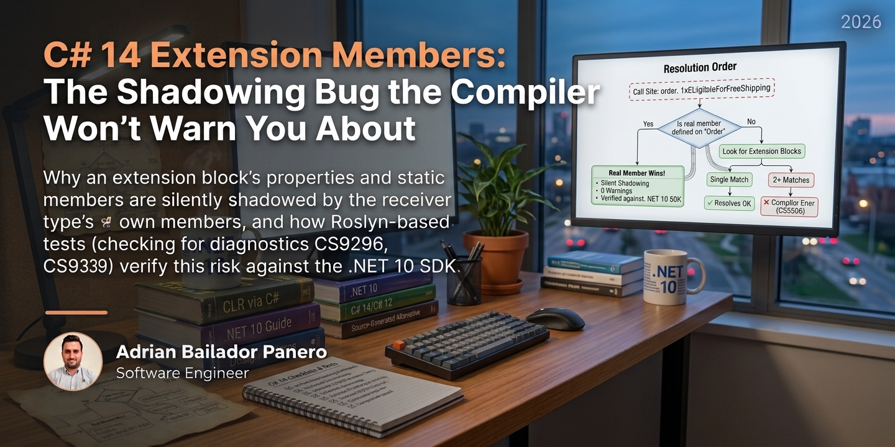

## Code

Every claim below is backed by a test — the full extension syntax, the two compiler diagnostics, and the silent shadowing behavior, each verified against the .NET 10 SDK rather than quoted from documentation: [csharp14-extension-members-dotnet10](https://github.com/AdrianBailador/csharp14-extension-members-dotnet10). 8 tests pass, and `dotnet build` produces 0 warnings — which is itself part of the point.

## A Property That Stopped Being Called, and Nothing Said So

A team extends `Order`, a record they don't want to touch directly because it's shared across three services, with a computed property for a shipping promotion:

```csharp
extension(Order order)
{
    public bool IsEligibleForFreeShipping => order.Total >= 50m && order.Region == "EU";
}
```

It ships. It's used at a dozen call sites, reading exactly like a real property because syntactically it is one now. That's the appeal of C# 14 extension members over the old `this`-parameter extension methods.

Weeks later, a different engineer promotes the same rule into a real member directly on `Order`, in an unrelated PR that has nothing to do with shipping. They're migrating business rules out of a service layer and into the domain model, and `IsEligibleForFreeShipping` happens to be one of dozens of properties that move. The rule itself also changed slightly: it now requires at least two line items, closing a loophole where a single expensive item triggered free shipping it shouldn't have.

The PR merges clean. CI is green. Nobody touched the original extension block, and nothing in the build output mentions it. But every call site that used to route through the extension now silently calls the real member instead: different logic, same name, zero warning, zero error. I reproduced this exact scenario against the .NET 10 SDK before writing this: `dotnet build` on [the companion repo](https://github.com/AdrianBailador/csharp14-extension-members-dotnet10) finishes with **0 Warning(s), 0 Error(s)**, while an entire extension member sits there, permanently unreachable.

This isn't new in kind. [C#'s extension method precedence rule](https://learn.microsoft.com/dotnet/csharp/programming-guide/classes-and-structs/extension-methods) has always said that a type's own member beats an extension method of the same signature, and Microsoft Learn confirms C# 14's extension member syntax follows that same rule. I haven't traced a specific project that broke this way, so take the next sentence as illustration, not as a demonstrated case — the demonstrated case is the one this article reproduces, below. .NET 6 adding `MinBy`, `MaxBy`, and `Chunk` to `IEnumerable<T>` is the shape of change the rule covers: any pre-existing extension method with one of those exact names and signatures would have been silently superseded on upgrade, with nothing in the build output marking the switch.

What's new in C# 14 is the surface area the rule now covers. Before, this only applied to methods — something you'd at least see as a call with parentheses, often with its own signature to compare. Now it applies to properties and static members too, each of which reads exactly like a real member at the call site, with nothing distinguishing "defined here" from "resolved from an extension block three files away."

## Where Extension Members Fit

An `extension` block in C# 14 lets a `static class` declare members (instance or static methods, properties, and operators) against a receiver type it doesn't own:

```csharp
public static class OrderExtensions
{
    extension(Order order)
    {
        public bool IsEligibleForFreeShipping => order.Total >= 50m && order.Region == "EU";

        public Order WithDiscount(decimal percent) =>
            order with { Total = order.Total * (1 - percent / 100m) };
    }
}
```

Architecturally, this sits in the same place classic extension methods always have: an ergonomics layer over types you can't or shouldn't modify — BCL types, sealed types, generated contracts, a shared library another team owns. It's not a layer, it's not a dependency boundary, and it carries no type identity of its own; `order.IsEligibleForFreeShipping` and a real `Order.IsEligibleForFreeShipping` are indistinguishable at every call site, which is precisely the property that makes them convenient and the property that makes shadowing invisible.

Whether you own the type matters, but it isn't a hard rule by itself. Extension members are also a legitimate choice on types you own — to keep presentation- or layer-specific logic out of a shared domain model, or to add a helper that only makes sense in one project (a mapping extension that belongs in the API layer, not the entity). The trade-off is what the rest of this article is about: a real instance member can't be shadowed by itself, shows up in the type's own file, and participates normally in interfaces and inheritance, none of which extension members do. The more central a piece of logic is to the type's own invariants — the kind of thing that should be true everywhere the type is used — the more that trade-off favors a real member over an extension, regardless of who owns the type.

Static extension members are the sharper edge of this trade-off. They're called as though declared on the type itself:

```csharp
extension(Order)
{
    public static Order Empty(string region) => new("empty", 0m, region, 0);
}
```

```csharp
var order = Order.Empty("US");
```

`Order.Empty(...)` reads exactly like a real static factory method, because nothing in C# syntax marks a static call as resolved through an extension. If `Order` is a type from a NuGet package you don't control, and a future version of that package adds a real `Empty` static member, your code keeps compiling. It just silently starts calling theirs.

## Before/After

### Before ❌
```csharp
public static class OrderExtensions
{
    extension(Order order)
    {
        // Nothing here signals that "IsEligibleForFreeShipping" is a name Order
        // might claim for itself later. No test pins what this currently returns.
        public bool IsEligibleForFreeShipping => order.Total >= 50m && order.Region == "EU";
    }
}
```

### After ✅
```csharp
// If you own Order: make it a real member. It can't be shadowed by itself,
// and it's visible in the type's own file to anyone reading it.
public sealed record Order(string Id, decimal Total, string Region, int LineItemCount)
{
    public bool IsEligibleForFreeShipping =>
        Total >= 50m && Region == "EU" && LineItemCount >= 2;
}
```

```csharp
// If you don't own it: keep the extension, but pin its current behavior with
// a value-asserting test — the compiler won't warn on a silent resolution
// change, so a test that checks the returned value is the most reliable
// deliberate signal available.
[Fact]
public void Real_member_rule_differs_from_the_stale_extension_for_single_item_orders()
{
    var order = new OrderV2("1", 75m, "EU", 1);

    Assert.False(order.IsEligibleForFreeShipping);
}
```

**Impact line:** In the reproduction above, promoting `IsEligibleForFreeShipping` to a real member on `OrderV2` while leaving the matching extension block untouched produces a build with 0 warnings and 0 errors — and every call site silently switches from the old two-condition rule to the new three-condition one. In the companion repo specifically, the only check that catches the switch is `ShadowingTests` — a test written to assert the returned *value*, not just that the code compiles; a general-purpose review of the diff that added the real member would catch it too, if the reviewer knew to look for the name collision.

## Resolution Order

![C# 14 extension member resolution: for order.IsEligibleForFreeShipping, the compiler first checks for a real member declared on Order — if found, it always wins silently with no warning, even if an extension member matches the same name. If not found, it looks for extension blocks declaring that name: exactly one match resolves normally, two or more matches fail to compile with CS9339. Independently of this flow, an extension property referenced inside an Expression<Func<T,...>>, such as an EF Core Where predicate, always fails to compile with CS9296.](extension-member-resolution.svg)

The two compile errors (`CS9339`, `CS9296`) are the safe outcomes: loud, immediate, impossible to ship. The dangerous branch is the one at the top with no error path at all: a real member found on the receiver type short-circuits extension resolution entirely, and the compiler has nothing to say about it even when an extension block defines the exact same name one file away.

## What They Don't Tell You

- **A real member always beats an extension member with the same name — silently, and there's no diagnostic for it.** Observed directly in [`ShadowingTests`](https://github.com/AdrianBailador/csharp14-extension-members-dotnet10/blob/main/tests/ExtensionMembers.Tests/ShadowingTests.cs): a record with a real `IsEligibleForFreeShipping` property and an extension block declaring the same name with deliberately different logic compiles with 0 warnings, and the real member's value is what's returned. Not a warning, not an info-level message — nothing.
- **Two extension blocks colliding on the same name is the opposite case: loud, not silent.** Two independently valid static classes, each declaring `IsEligibleForFreeShipping` on `Order`, fail to compile the moment both are in scope at a call site — `CS9339`, ambiguous extension resolution, asserted in [`Two_extension_blocks_declaring_the_same_member_name_fail_with_CS9339`](https://github.com/AdrianBailador/csharp14-extension-members-dotnet10/blob/main/tests/ExtensionMembers.Tests/CompilerDiagnosticsTests.cs). The dangerous case is specifically *extension vs. real member*, not *extension vs. extension* — the compiler already catches the second one.
- **Extension properties can't appear inside expression trees — a compile-time restriction, not a runtime EF Core surprise.** Documented on the [`extension` declarations reference](https://learn.microsoft.com/en-us/dotnet/csharp/language-reference/keywords/extension) and reproduced in [`Extension_property_inside_an_expression_tree_fails_with_CS9296`](https://github.com/AdrianBailador/csharp14-extension-members-dotnet10/blob/main/tests/ExtensionMembers.Tests/CompilerDiagnosticsTests.cs): `order => order.IsEligibleForFreeShipping` inside an `Expression<Func<Order, bool>>` — what an EF Core `Where(...)` predicate compiles to — fails with `CS9296` before the code ever ships.
- **Static extension call syntax is indistinguishable from a real static member at the call site.** `Order.Empty(...)` reads identically whether `Empty` is declared on `Order` or arrives from an extension block. "Go to Definition" can resolve to the extension block in most current IDEs, but that's tooling behavior, not a language guarantee — and unlike extension *methods*, which some IDEs still mark with a distinct icon, nothing in the syntax itself flags a static call as coming from an extension.
- **Generic type parameter placement is a compile-time-only trap, but still a real one.** Per the [same reference](https://learn.microsoft.com/en-us/dotnet/csharp/language-reference/keywords/extension#generic-extension-blocks): a type parameter used in the receiver goes on the `extension<T>(...)` declaration; one used only by a specific member goes on that member. Put it in the wrong place and the error is about the parameter, not about which declaration it belongs on.

## Best Practices

1. **Weigh ownership as a factor, not a rule.** Favor a real member as logic gets closer to a type's own invariants; extension blocks remain reasonable for BCL types, sealed types, shared contracts, and layer-specific helpers, including on types you own.
2. **Pair a value-asserting test with diff review, not either alone.** A test is only as good as the case it exercises, and a passing suite doesn't rule out an uncovered shadowing case — review diffs that add a member name an extension block already claims.
3. **Avoid naming an extension member after anything the receiver's own maintainer might plausibly add later.** `IsValid`, `IsEmpty`, and `Count` are the kind of names framework authors reach for; see the precedence rule above for why that matters.
4. **Keep extension properties out of `IQueryable<T>` predicates.** `CS9296` enforces this, but hitting it mid-sprint is wasted iteration — write query-facing logic as real instance members or explicit `Expression<Func<T, TResult>>` factories from the start.
5. **One extension block per receiver per static class, for types shared across a codebase.** It narrows the chance that two files, or two teams, independently collide on `CS9339` at merge time instead of during local development.
6. **Use the migration compatibility deliberately, not as a rewrite mandate.** Classic `this`-parameter extension methods and `extension`-block members [compile to identical IL and are binary- and source-compatible](https://learn.microsoft.com/en-us/dotnet/csharp/language-reference/keywords/extension) — modernize incrementally where it earns its keep.
7. **Document the `extension(...)` block itself, not just the members inside it.** [The compiler copies XML comments from the block to every generated member](https://learn.microsoft.com/en-us/dotnet/csharp/language-reference/keywords/extension), and the block is the only place in the file that visibly declares a receiver has extensions at all.

## Conclusion

Extension members are compiler sugar over static dispatch, following [the same precedence rule classic extension methods have always had](https://learn.microsoft.com/dotnet/csharp/programming-guide/classes-and-structs/extension-methods): a real member wins, silently, no diagnostic. What's different in C# 14 is the surface that rule now covers — properties and statics, not just methods — written in syntax a reader has no way to tell apart from the real thing.

That's a reason to be deliberate about where you reach for `extension`, not a reason to avoid it. On types you don't own, or for logic that's genuinely peripheral to a type's own behavior, the risk is proportional to how often that type changes under you — usually rare enough to live with. The closer a piece of logic gets to a type's own invariants, the more a real member earns its keep: it's the same line of code, just placed where it can't be shadowed by itself and where a reader doesn't need to know the precedence rule to trust what they're looking at.

C# 15 adds extension indexers under [the same resolution rules](https://learn.microsoft.com/en-us/dotnet/csharp/language-reference/keywords/extension) documented here. The surface keeps growing; the rule that matters doesn't change.
