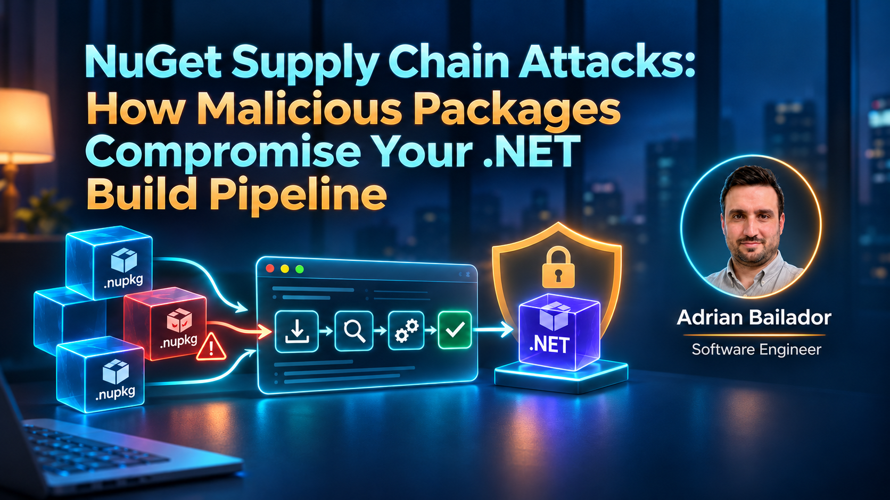

## Code

Every claim below is backed by a test, not a blog-post assumption — the build-time execution PoC, the NU1100 failure from package source mapping, and the pre-populated-cache pitfall, each reproduced against the .NET 10 SDK in an isolated, self-cleaning copy of the repo: [nuget-supply-chain-defense-dotnet10](https://github.com/AdrianBailador/nuget-supply-chain-defense-dotnet10). 2 tests, 0 warnings. The PoC payload is intentionally harmless — it only writes a local marker file — and it's never published to nuget.org or any public feed. Read the repo's README for the scope and safety boundaries before you go digging through the code.

## The Dependency Nobody Reviewed

A pull request adds one line to a `.csproj`: a `PackageReference` to a package that resolves a transitive dependency your team actually needed. The diff is three lines. CI runs, restore succeeds, build succeeds, tests pass, it merges. Nobody opened the package. Nobody had to — `dotnet restore` did that part automatically, and the reviewer's job was the C# that called it, not the MSBuild logic that shipped inside it.

That second part is the problem. A NuGet package isn't just a DLL and some metadata — it's also an MSBuild extension point. Since 2017, the SDK-style project format auto-imports any `build/` or `buildTransitive/` `.targets` file a package ships, for every project that references it directly *or transitively*, with zero code in your `Program.cs` asking for it. The 2022–2023 wave of malicious NuGet packages that security researchers at ReversingLabs, Checkmarx, and others documented — typosquatted names, IL-weaving payloads, packages designed to look like internal tooling — relied on exactly this: the build pipeline trusts a package the moment it resolves, and resolution happens before a human looks at anything.

Most public writeups about these incidents describe the blast radius — what got exfiltrated, which teams were affected — and skip the mechanism, so here it is, along with the three pieces of `NuGet.config`/`.csproj` configuration that turn "any package, any source" into "only the sources I named can answer for a given package ID." That's a narrower claim than "only safe packages" — it closes off *where* an unreviewed package can come from, not *what* an allowed one does.

## Where This Sits Architecturally

Dependency resolution is usually filed under "tooling," which is why it rarely gets the scrutiny your actual authorization code does. It shouldn't be. The trust boundary that matters here isn't your API's edge — it's the moment `dotnet restore` decides which bytes to pull onto a machine that then *executes arbitrary build logic* with the same privileges as whatever ran the build. On a CI runner, that's usually enough to read environment variables, a cloned repo with its `.git` history, and any secret the pipeline injected for deployment.

Three things decide how exposed you actually are:

- **Source trust is binary per-project, not per-package, by default.** If `nuget.org` and an internal feed are both configured sources with no mapping, *either* can satisfy *any* package ID. A package name that merely resembles something you trust is enough.
- **Restore and build are not separable security boundaries.** People reason about "what runs in production" as the thing to lock down, and treat the build step as inert. It isn't — `BeforeTargets="Build"` runs on every developer machine and every CI agent that builds the project, which is a much larger and less monitored surface than production.
- **Reproducibility and security are the same property here.** A floating version range (`Version="[1.0.0,2.0.0)"`) isn't just a reproducibility risk — it's an open invitation for a new published version, malicious or merely broken, to enter your build without a code change to review.

None of this means "stop using NuGet," any more than SQL injection means "stop using SQL." It means the restore step deserves the same deliberate configuration as the rest of your pipeline — and in practice it's easy for a repo to end up with none of it, because an unmapped `NuGet.config` never fails a build until the day it matters.

## Proving the Attack Surface Is Real

The companion repo's `EvilPkg.Benign` package exists to make the mechanism undeniable rather than theoretical. Its entire payload is one MSBuild file, auto-imported from `buildTransitive/`:

```xml
<!-- buildTransitive/EvilPkg.Benign.targets -->
<Project>

  <Target Name="EvilPkgBenignPoC" BeforeTargets="Build">
    <PropertyGroup>
      <_PoCMarkerPath>$([System.IO.Path]::Combine('$(MSBuildProjectDirectory)', 'supply-chain-poc-marker.txt'))</_PoCMarkerPath>
      <_PoCLine>supply-chain-poc executed at $([System.DateTime]::UtcNow.ToString('o')) for project $(MSBuildProjectName) (user=$([System.Environment]::UserName))</_PoCLine>
    </PropertyGroup>

    <WriteLinesToFile File="$(_PoCMarkerPath)" Lines="$(_PoCLine)" Overwrite="true" />

    <Message Importance="high" Text="[EvilPkg.Benign] Build-time PoC executed for $(MSBuildProjectName)." />
  </Target>

</Project>
```

`VictimApp` references this package with nothing else configured — the common real-world default:

```xml
<!-- VictimApp.csproj -->
<ItemGroup>
  <PackageReference Include="EvilPkg.Benign" Version="1.0.0" />
</ItemGroup>
```

Running `dotnet build` on `VictimApp` produces this, verbatim, with no code in `Program.cs` doing anything related to it:

```
[EvilPkg.Benign] Build-time PoC executed for VictimApp. This proves a
referenced NuGet package ran MSBuild logic during 'dotnet build' with
no call in your own code.

Build succeeded.
```

And a `supply-chain-poc-marker.txt` appears next to the project, written by code that your pull request review never saw because it isn't C#. Swap `WriteLinesToFile` for `<Exec Command="curl ... | sh" />` and you have the shape of every "build-time exfiltration" incident from the last few years — the mechanism, not a hypothetical one.

## Before/After: Package Source Mapping

### Before ❌
```xml
<!-- src/VictimApp/NuGet.config -->
<configuration>
  <packageSources>
    <clear />
    <add key="nuget.org" value="https://api.nuget.org/v3/index.json" />
    <add key="local-lab-feed" value="../../local-lab-feed" />
  </packageSources>
  <!-- No <packageSourceMapping>: both sources can satisfy any package ID. -->
</configuration>
```
With no mapping, every configured source is eligible for every package ID — NuGet doesn't restrict resolution to "the source you meant." Which source actually answers for a given ID depends on config and feed details you don't control project-by-project, so it isn't something to reason about, let alone rely on. Adding a second source — a vendor feed, an internal Azure Artifacts feed, anything — silently widens the attack surface for *every* package your project already references, including the ones you trust completely.

### After ✅
```xml
<!-- src/DefensiveApp/NuGet.config -->
<configuration>
  <packageSources>
    <clear />
    <add key="nuget.org" value="https://api.nuget.org/v3/index.json" />
    <add key="local-lab-feed" value="../../local-lab-feed" />
  </packageSources>

  <packageSourceMapping>
    <packageSource key="nuget.org">
      <package pattern="Microsoft.*" />
      <package pattern="System.*" />
    </packageSource>
    <!-- local-lab-feed owns no pattern: nothing can resolve from it. -->
  </packageSourceMapping>
</configuration>
```
Adding `PackageReference Include="EvilPkg.Benign"` to a project governed by this config and running `dotnet restore` — no `--source` override, the exact shape a real PR would take — fails before a single build target runs:

```
error NU1100: Unable to resolve 'EvilPkg.Benign (>= 1.0.0)' for 'net10.0'.
PackageSourceMapping is enabled, the following source(s) were not
considered: local-lab-feed, nuget.org.
```

**Impact, measured, not estimated:** in the test suite, the unmapped project restores, builds, and executes the dependency's MSBuild target in under a second — the attack completes before a human could `Ctrl+C`. The mapped project's restore fails in 557ms, before `dotnet build` is even invoked. The difference isn't "slower" vs. "faster" — it's "attacker code never executes" vs. "attacker code already ran."

## Dependency Resolution and the Trust Boundary

![NuGet supply chain trust boundary: the same PackageReference goes through dotnet restore in both VictimApp and DefensiveApp. Without packageSourceMapping, VictimApp resolves the package from local-lab-feed, then dotnet build auto-imports its buildTransitive/*.targets, which runs with full build-agent privileges — reaching environment variables, CI secrets, and the source tree. With packageSourceMapping configured, DefensiveApp's restore finds no source with a matching pattern and fails with NU1100 before dotnet build ever starts, so nothing executes.](supply-chain-trust-boundary.svg)

The box worth staring at is `dotnet build`, not `dotnet restore`. Restore just decides which bytes land on disk; build is where those bytes get to run code.

Worth being precise about what each mitigation in this article actually tests for, since they're not interchangeable. Source mapping is the one this repo verifies blocks `EvilPkg.Benign`: it's a restore-time gate on *where a package ID is allowed to come from*. A committed lock file plus `--locked-mode` is a different property — it pins the dependency graph so it can't silently change, which makes an unreviewed addition show up as a diff, but it says nothing about whether a package already in that graph is safe. Central package management centralizes *where a version is set*, so a repin is a one-file, reviewable change instead of scattered across `.csproj` files — again, not a check on package behavior. None of the three, alone or stacked, inspects what a package's code or build targets actually do; they narrow who gets to introduce a dependency and make sure that introduction leaves a paper trail. That's a meaningfully smaller claim than "stops malware," and it's the claim this article actually backs with a test.

## Pitfalls in Production

**A pre-populated NuGet cache defeats source mapping silently.** This is the one that will actually bite you: the first time I tested `DefensiveApp`'s mapping by hand, `dotnet add package EvilPkg.Benign --source ../../local-lab-feed` followed by `dotnet restore` succeeded despite the mapping having no pattern for it. The cause was `~/.nuget/packages`: an earlier, unmapped operation had already cached `evilpkg.benign` locally, and restore served it from cache without re-checking source eligibility. Deleting that one package's cache folder (`rm -rf ~/.nuget/packages/evilpkg.benign`) and rerunning `dotnet restore` reproduced the `NU1100` failure. The test suite avoids this entirely by giving each run its own empty `NUGET_PACKAGES` directory — that's the only configuration this article's NU1100 result is verified against. A warm, shared cache is a different scenario, and this article doesn't test it: assume mapping needs a clean cache to prove anything, and give CI an isolated `NUGET_PACKAGES` path per run rather than trusting a long-lived one.

**`VersionOverride` is the hole in central package management's wall.** CPM forbids a `Version` attribute on `PackageReference` (`NU1008`) specifically so nobody can silently repin a dependency outside the reviewed, centralized list. `VersionOverride` is the documented escape hatch for the rare legitimate exception — and it's also the shape a malicious or careless PR would use to reintroduce an unreviewed version. Treat any PR touching `VersionOverride` as a mandatory, named reviewer path, not a routine dependency bump.

**Locked-mode has to be requested; a plain `dotnet restore` won't enforce it.** `RestorePackagesWithLockFile=true` keeps `packages.lock.json` up to date, but a bare `dotnet restore` will happily *update* the lock file to match a changed dependency graph instead of failing. The enforcement only happens with `dotnet restore --locked-mode`, which is a CI pipeline setting, not a project file setting — easy to configure once and then forget to verify after a pipeline migration.

**MSBuild targets run as the build identity, not as your application's identity.** The marker-file PoC is deliberately boring, but the privilege it demonstrates isn't: anything a developer's shell or a CI runner's service account can reach — environment variables, injected secrets, the full checked-out source tree, often a writable network path — is reachable from `BeforeTargets="Build"`. Treat build-agent credentials with the same care as production credentials — build-time code execution hands an attacker the former, not the latter, and the former is usually broader in scope and watched less closely.

## Best Practices

1. **Enable package source mapping for every project with more than one configured source.** The moment a second source exists — a private feed, a vendor feed, a mirror — mapping stops being optional. It's the single control that turns "any source, any package" into an explicit allowlist, and it costs a few lines of `NuGet.config`.
2. **Commit `packages.lock.json` and run restore in locked mode in CI.** `RestorePackagesWithLockFile=true` plus `dotnet restore --locked-mode` means a dependency graph change requires a reviewable diff, not a silent re-resolution against whatever is live today.
3. **Centralize versions with `Directory.Packages.props`, and gate `VersionOverride` behind review.** One file, one place a dependency version is set, with a named exception path that's loud, not quiet, when it's used.
4. **Test your security configuration against a clean environment, not your warm dev machine.** A pre-populated global package cache can make a broken mapping look like it's working. CI should use an isolated package cache per run — most hosted CI already does this by default; verify yours does.
5. **Pin exact versions; stop using floating ranges in anything that reaches production.** A `[1.0.0,2.0.0)` range means a package author's next publish — benign, broken, or compromised — enters your build with no diff for anyone to review.
6. **Run `dotnet list package --vulnerable` and an SBOM export (CycloneDX or SPDX) as a CI gate, not a quarterly chore.** Source mapping stops an unrelated malicious package; it does nothing for a legitimate package with a disclosed CVE in a version you're already pinned to.
7. **Audit who can add a new package source, not just who can add a package.** Source mapping is only as strong as the source list it governs — a `NuGet.config` change that adds an unmapped or over-broadly-mapped source quietly reopens everything the mapping was protecting.

## Closing

The mistake isn't "we didn't scan for malware" — it's treating dependency resolution as a tooling detail instead of a trust boundary with the same weight as your API's authentication layer. Source mapping, a locked restore, and central package management don't need a security team or a new vendor. They need one decision, made once — which sources get to answer for which package names — and then letting NuGet enforce it on every restore, instead of hoping someone reviews every transitive dependency by hand.

Use this the moment your project pulls from more than one source, which is most real projects as soon as an internal feed exists. Skip it only for a disposable sample with a single trusted source — and even then, commit the lock file anyway; it costs nothing. The step most teams never take after this is treating the SBOM their build already produces as something you actually query, not a file generated once and forgotten. Skip that, and "what's running in production" stays a question you answer by opening sixteen `.csproj` files under deadline — every single time.
