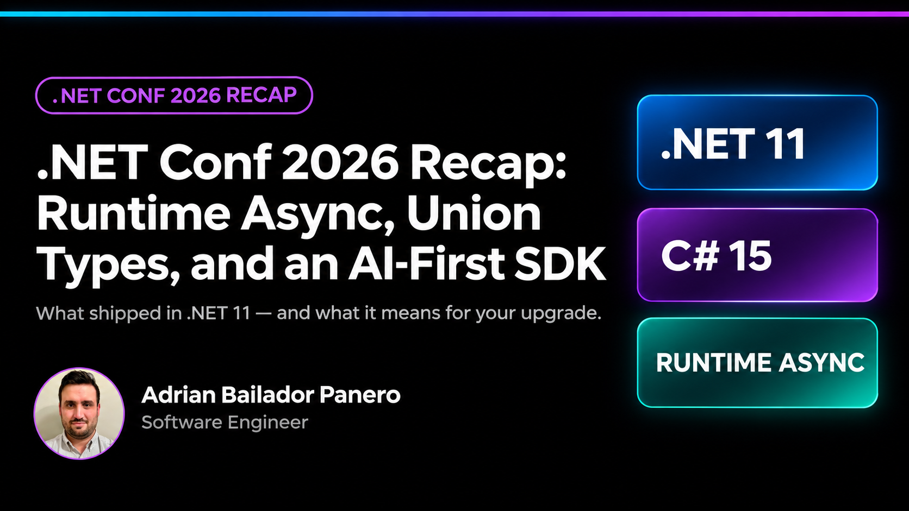

.NET Conf 2026 ran November 10–12, and the keynote — Scott Hanselman and Damian Edwards — did what every .NET Conf keynote does: thirty minutes of "here's what shipped" wrapped around ninety minutes of "here's where Copilot and agents fit into your workflow now." If you'd rather watch a condensed version than the full three days, [this 26-minute recap](https://youtu.be/QJC5CXtVIZ0) covers .NET 11, C# 15, and the Aspire-side tooling without the keynote padding.

I watched the sessions that matter for production work — not the demo-driven ones — and cross-checked every claim below against [Microsoft's own "What's new in .NET 11" page](https://learn.microsoft.com/en-us/dotnet/core/whats-new/dotnet-11/overview) and the [GA announcement](https://devblogs.microsoft.com/dotnet/?p=61205), because conference-talk framing and shipped-feature reality don't always match. This isn't a feature list. It's what changed since the previews, what's still half-baked, and what should actually move your upgrade timeline.

## The Fact That Matters More Than Any Feature

.NET 8 and .NET 9 both reached end of support on November 10, 2026 — the same day .NET 11 shipped. If you're running either in production, this conference wasn't optional viewing; it was a deadline. .NET 11 is a **Standard Term Support (STS)** release: two years of support, same servicing quality as an LTS, shorter runway. .NET 10 is still the LTS option if you want three years and would rather skip a release.

That's the real choice: upgrade again in two years on the STS track, or stay on .NET 10 LTS and skip .NET 11 outright. Everything below is what decides which one makes sense for you.

## C# 15 Is Final — and the Preview-to-GA Diff Matters

I [covered C# 15's union types and closed hierarchies in detail back in July](/blog/64-csharp-15-union-types-closed-hierarchies), when they were still preview-only and the design was being argued on GitHub in real time. They shipped. C# 15 is now the default language version for any project targeting `net11.0`, and the two headline features — union types with exhaustiveness checking, and closed hierarchies restricted to the declaring assembly — landed exactly as designed, plus collection expression arguments, extension indexers, and labeled `break`/`continue`.

One thing changed between preview and GA that's easy to miss: **memory safety stayed in preview**. If you read "C# 15 ships memory safety" in a summary somewhere, that's aspirational, not shipped — Microsoft's own GA page still lists it as preview work. Don't write migration docs around it yet.

The other piece worth flagging for teams that already adopted the preview: `System.Text.Json` now serializes C# and F# unions natively, and ASP.NET Core's model binding understands union types in request/response bodies. If you built a hand-rolled `JsonConverter` for your union types during the preview window, that's dead code now — rip it out before someone "fixes" a bug in it six months from now.

## Runtime Async Stopped Being a Feature Flag

This is the change I'd put at the top of any internal "should we upgrade" writeup, and it's the one the keynote undersold.

Through the .NET 11 previews, Runtime Async — moving async suspension and resumption out of Roslyn-generated state machines and into the runtime itself — required `<EnablePreviewFeatures>true</EnablePreviewFeatures>`. At GA, that requirement is gone for anything targeting `net11.0`. The BCL itself is compiled with `runtime-async=on`. This isn't an opt-in anymore; it's the ground your `async`/`await` code stands on by default.

Practically, that means:

- **Cleaner stack traces.** No more `MoveNext()` noise through six frames of compiler-generated state machine when an exception propagates through nested `await` calls.
- **Lower allocation overhead on the hot path.** The runtime talk (Richard Lander and Andy Gocke, Day 1) walked through JIT'd runtime-async versions of synchronous task-returning methods, `ExecutionContext` capture skipped when there's no ambient state, and tail-merged suspension points that shrink generated code size.
- **A real migration question for libraries.** If you ship a NuGet package with hand-tuned `ValueTask`-based async paths to dodge state-machine allocation, re-benchmark on .NET 11 before assuming your workaround still earns its complexity. Some of it just became the runtime's job.

This is the kind of change that doesn't show up in a changelog bullet point as anything scary, but it's a bigger shift in how async code executes than anything C# 15 shipped at the language level.

## .NET 11 Numerics: Decimal Floats and Generic Complex Numbers

Tanner Gooding's numerics session covered three additions worth knowing exist even if you won't touch them this quarter:

```csharp
// IEEE 754 decimal floating-point — new in .NET 11
Decimal32 price = Decimal32.Parse("19.99");
Decimal64 total = Decimal64.Parse("1999999.995");

// Generic complex numbers — no longer locked to double
Complex<float> signal = new(3.0f, 4.0f);
```

`Decimal32`, `Decimal64`, and `Decimal128` give you IEEE-compliant decimal floating-point distinct from the existing `System.Decimal` — relevant if you're interoperating with systems (financial, scientific) that specify IEEE decimal semantics rather than .NET's base-10 fixed-point type. `Complex<T>` finally makes complex-number math generic instead of hardcoded to `double`. Neither is a feature most line-of-business teams reach for, but if you've been shimming IEEE decimal behavior with manual rounding, check whether these replace it.

## ASP.NET Core and Blazor: Async Validation Finally Ships

Daniel Roth's web session is the one actually worth reading if you run ASP.NET Core in production:

- **Asynchronous validation** via `AsyncValidationAttribute`, `IAsyncValidatableObject`, and `Validator.ValidateObjectAsync` — the thing every team has hand-rolled at least once to check "does this email already exist" without blocking a thread.
- **OpenAPI 3.2 as the default** for generated API documents. If you have tooling pinned to 3.0/3.1 output shape, check it before upgrading — this is a default change, not opt-in.
- **Minimal APIs understand C# unions** directly in request and response bodies, which closes the loop with the `System.Text.Json` union support mentioned above.
- **Blazor Server** adds persistent component state and circuit pause/resume — relevant if you've been fighting circuit-reconnection UX on flaky connections.
- **Experimental agentic UI work** — AG-UI protocol support and prerelease Blazor AI components, built on the Microsoft Agent Framework. This is genuinely experimental; don't plan a Q1 roadmap around it.

EF Core 11 shipped alongside, with fewer unnecessary joins, better `GroupBy` translation to SQL, and an experimental SQL Server vector search — the last one aimed squarely at teams building RAG pipelines who'd rather not stand up a separate vector store.

## The AI Framing Wasn't Just Keynote Fluff

Every .NET Conf keynote since 2024 has had an AI segment, and it's tempting to tune it out. This year's is worth a few minutes, specifically because the SDK changed, not just the demos: .NET 11's SDK ships an MCP server template out of the box, and v2.0 of the official MCP C# SDK — stateless-by-default protocol handling — released alongside it. Combined with `Microsoft.Extensions.AI` and the Microsoft Agent Framework, this is Microsoft consolidating "how do I expose my .NET service to an agent" into a first-party, scaffolded answer instead of a pile of community packages. If you've been building MCP servers against the 1.x SDK, read the stateless-by-default change before you upgrade — it changes what you can assume about request lifetime.

## What the Keynote Didn't Dwell On

- **Runtime Async's edge cases aren't free.** Tail-merged suspension and skipped `ExecutionContext` capture are performance wins precisely because they change behavior at the margins. If you have code relying on ambient `ExecutionContext` state flowing through every `await` — custom `AsyncLocal` tracing, for instance — test it explicitly. The optimization only skips capture "when no ambient state is in use," which means *your* code is what determines whether you get the fast path.
- **Native AOT CLI changes your startup profile, not your app's.** The SDK's new NativeAOT CLI entry point speeds up `dotnet` command invocation itself (useful in CI, useful for `dotnet watch` loops). It has nothing to do with whether your application is published Native AOT — don't conflate the two when explaining this to a team that asked "did we get faster."
- **Memory safety is still preview.** Said above, worth saying twice given how often "C# 15 ships memory safety" circulates as a flat claim.

## Should You Actually Upgrade Now?

1. **On .NET 8 or .NET 9 today:** you're already unsupported as of November 10. This isn't a "should I" — move to .NET 10 (LTS) or .NET 11 (STS) on your normal patch cadence, now.
2. **On .NET 10 and stable:** .NET 10 is LTS through 2028. Nothing in this release — not union types, not Runtime Async leaving preview — is a forcing function to jump to an STS release a year early. Stay, unless you specifically need something from the list above (async validation, the numerics types, the MCP SDK v2).
3. **Building a library or shared package:** target `net11.0` in a side branch now and re-benchmark your async-heavy paths against Runtime Async. This is the release where hand-tuned workarounds for state-machine overhead start getting redundant, and you want to know that before a consumer asks why your package still ships the old workaround.
4. **Shipping anything with MCP:** read the v2.0 SDK's stateless-by-default change before touching the upgrade. That's a behavioral change, not a version bump.

Same pattern as every .NET Conf since .NET 6: the keynote sells AI, the session talks ship the actual infrastructure. Runtime Async quietly losing its preview flag is the bigger story here, not anything that got demoed live. Base the upgrade call on the support table above, not on how the keynote framed it.

**Sources:** [What's new in .NET 11 (Microsoft Learn)](https://learn.microsoft.com/en-us/dotnet/core/whats-new/dotnet-11/overview) · [.NET 11 GA announcement](https://devblogs.microsoft.com/dotnet/?p=61205) · [.NET Conf 2026 agenda](https://dotnet.microsoft.com/en-us/conf/2026/agenda) · [NetConf 2026 in 26 minutes (YouTube)](https://youtu.be/QJC5CXtVIZ0)
